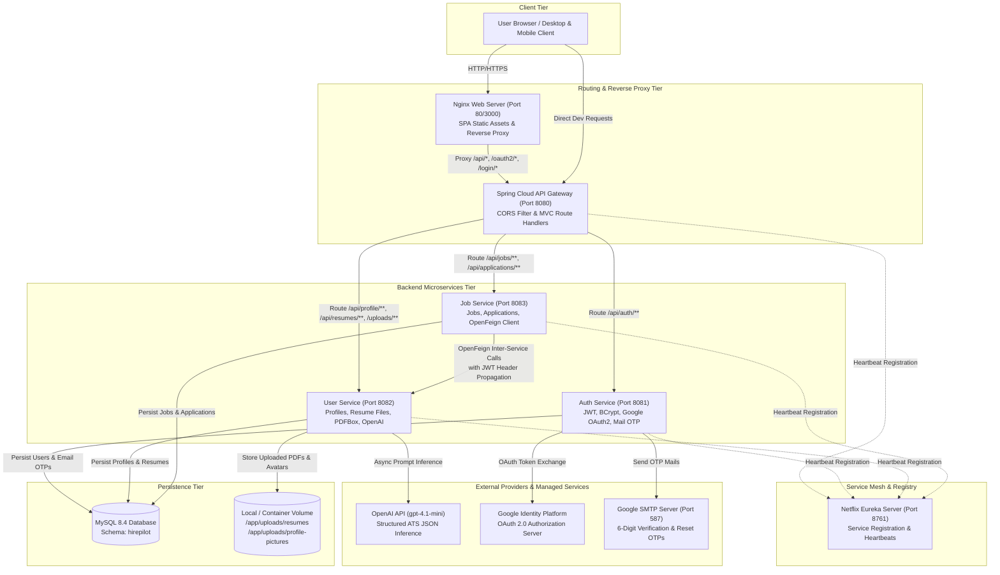
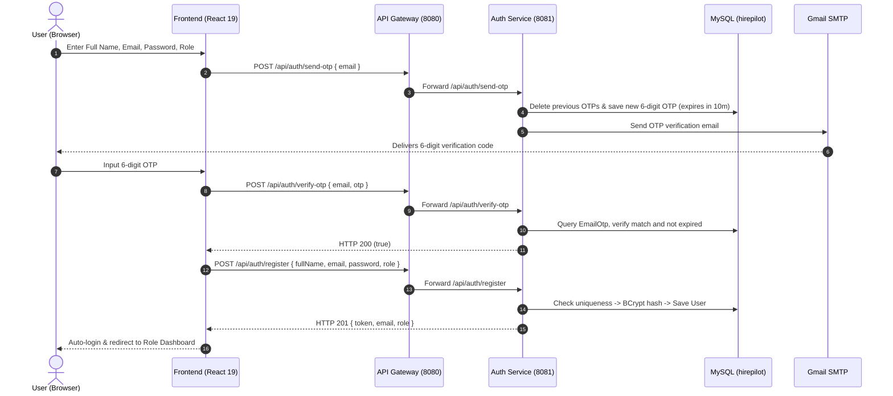
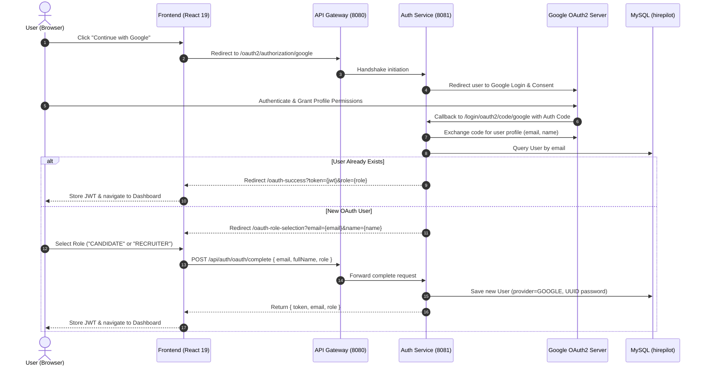
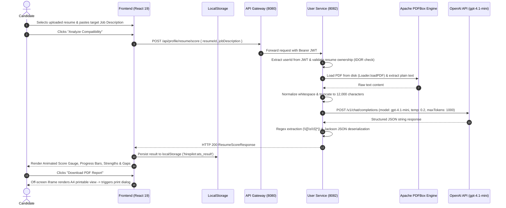
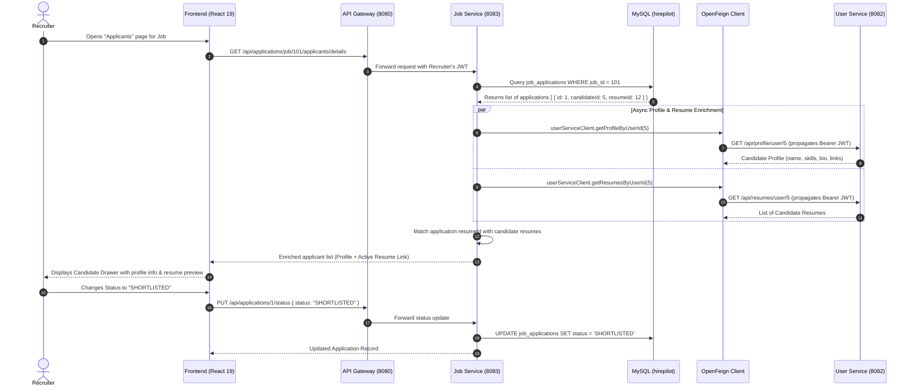
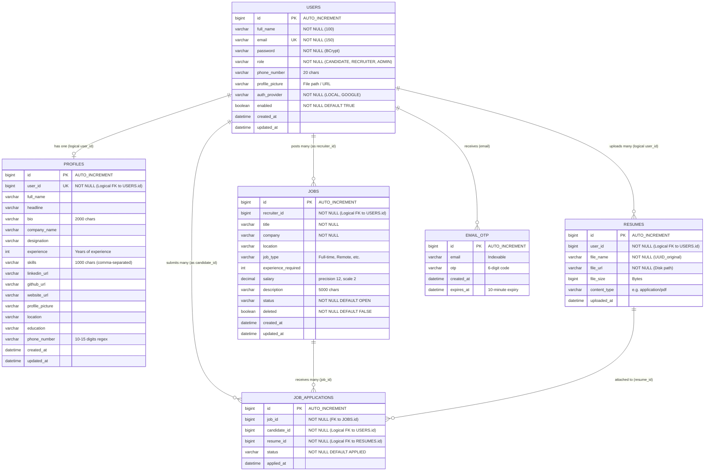

# HirePilot AI — Intelligent Recruitment & Career Intelligence Platform

[](https://spring.io/projects/spring-boot)
[](https://spring.io/projects/spring-cloud)
[](https://react.dev/)
[](https://www.typescriptlang.org/)
[](https://vitejs.dev/)
[](https://platform.openai.com/)
[](https://www.mysql.com/)
[](https://www.docker.com/)

> **HirePilot AI** is an enterprise-grade recruitment and career acceleration platform built on a distributed microservices architecture. It bridges candidates and recruiters through AI-driven Applicant Tracking System (ATS) resume compatibility scoring, automated PDF text extraction, role-specific career workflows, and end-to-end job application lifecycle tracking.

---

## Table of Contents

- [1. Project Overview](#1-project-overview)
- [2. System Architecture](#2-system-architecture)
  - [Microservices Ecosystem](#microservices-ecosystem)
  - [High-Level Architecture Diagram](#high-level-architecture-diagram)
  - [Network & Service Topologies](#network--service-topologies)
- [3. Key Features](#3-key-features)
  - [Candidate Experience](#candidate-experience)
  - [Recruiter Portal](#recruiter-portal)
  - [AI & Resume Intelligence](#ai--resume-intelligence)
  - [Authentication & Access Security](#authentication--access-security)
  - [Administrator Module](#administrator-module)
- [4. Technology Stack](#4-technology-stack)
- [5. How the Application Works (End-to-End Workflows)](#5-how-the-application-works-end-to-end-workflows)
  - [Workflow 1: User Registration & Email OTP Verification](#workflow-1-user-registration--email-otp-verification)
  - [Workflow 2: Authentication & JWT Issuance](#workflow-2-authentication--jwt-issuance)
  - [Workflow 3: Google OAuth2 Login & Role Onboarding](#workflow-3-google-oauth2-login--role-onboarding)
  - [Workflow 4: Forgot Password & OTP Password Reset](#workflow-4-forgot-password--otp-password-reset)
  - [Workflow 5: Resume Ingestion & Storage](#workflow-5-resume-ingestion--storage)
  - [Workflow 6: AI-Powered ATS Resume Scoring Pipeline](#workflow-6-ai-powered-ats-resume-scoring-pipeline)
  - [Workflow 7: Job Creation & Candidate Job Search](#workflow-7-job-creation--candidate-job-search)
  - [Workflow 8: Job Application & Inter-Service Recruiter Enrichment](#workflow-8-job-application--inter-service-recruiter-enrichment)
- [6. AI Resume Scoring Pipeline Deep Dive](#6-ai-resume-scoring-pipeline-deep-dive)
- [7. Database Architecture & Data Models](#7-database-architecture--data-models)
  - [Entity-Relationship Diagram](#entity-relationship-diagram)
  - [Database Schemas & Field Mappings](#database-schemas--field-mappings)
- [8. API Reference](#8-api-reference)
  - [Authentication Service (`/api/auth/**`)](#authentication-service-apiauth)
  - [User & Profile Service (`/api/profile/**`, `/api/resumes/**`)](#user--profile-service-apiprofile-apiresumes)
  - [Job & Application Service (`/api/jobs/**`, `/api/applications/**`)](#job--application-service-apijobs-apiapplications)
- [9. Repository Structure](#9-repository-structure)
- [10. Prerequisites & Requirements](#10-prerequisites--requirements)
- [11. Environment Configuration](#11-environment-configuration)
  - [Configuration Variable Matrix](#configuration-variable-matrix)
  - [Sample `.env` File](#sample-env-file)
- [12. Local Setup & Installation](#12-local-setup--installation)
  - [Method A: Full Docker Compose Environment (Recommended)](#method-a-full-docker-compose-environment-recommended)
  - [Method B: Bare-Metal Development (Manual Launch)](#method-b-bare-metal-development-manual-launch)
- [13. Docker & Production Deployment](#13-docker--production-deployment)
  - [Container Infrastructure Breakdown](#container-infrastructure-breakdown)
  - [Docker Maintenance Commands](#docker-maintenance-commands)
  - [AWS Production Architecture](#aws-production-architecture)
- [14. Security Architecture & Best Practices](#14-security-architecture--best-practices)
- [15. Verification, Testing & Troubleshooting](#15-verification-testing--troubleshooting)
- [16. Implementation Status & Product Roadmap](#16-implementation-status--product-roadmap)
- [17. Contributing & Licensing](#17-contributing--licensing)

---

## 1. Project Overview

Modern hiring workflows suffer from two major friction points:
1. **Candidates** submit resumes blindly to online job portals without knowing if their profile satisfies corporate Applicant Tracking System (ATS) parsing algorithms or matches keyword criteria.
2. **Recruiters** struggle to filter through hundreds of unstructured applications, manually cross-referencing candidate contact profiles, portfolios, and uploaded documents.

**HirePilot AI** solves these challenges by combining a modular Java Spring Cloud microservice architecture with a reactive React 19 single-page application and modern Generative AI capabilities via OpenAI.

```
       Candidate Experience                          Recruiter Operations
 ┌───────────────────────────────┐             ┌───────────────────────────────┐
 │ • Resume Upload & Management  │             │ • Multi-Criteria Job Creation │
 │ • AI ATS Resume Alignment     │             │ • Applicant Drawer & Pipeline │
 │ • One-Click Job Applications  │  ◄────────► │ • Dynamic Status Progression  │
 │ • Real-Time Pipeline Tracking │             │ • Enriched Candidate Profiles │
 └───────────────────────────────┘             └───────────────────────────────┘
                                 ▲             ▲
                                 │             │
                                 └───┬─────┬───┘
                                     │     │
                                     ▼     ▼
                        ┌───────────────────────────────┐
                        │       Spring Cloud Gateway    │
                        │    Eureka Service Discovery   │
                        │       MySQL 8.4 Engine        │
                        │    OpenAI GPT-4.1-mini LLM    │
                        └───────────────────────────────┘
```

### Production Deployments & Repository Info
- **GitHub Repository:** [https://github.com/sr-nagaraj/HirePilot.git](https://github.com/sr-nagaraj/HirePilot.git)
- **Active Git Branches:** `backend` (active development), `production` (production releases)
- **Live Production Frontend:** [https://hirepilotai.xyz](https://hirepilotai.xyz) *(Configured via AWS ALB)*
- **Live Production API Gateway:** [https://api.hirepilotai.xyz](https://api.hirepilotai.xyz) *(Configured via AWS ALB)*

---

## 2. System Architecture

HirePilot AI is engineered around autonomous microservices adhering to bounded context domain separation. Inter-service dependencies are decoupled via dynamic service registration and client-side declarative HTTP interfaces.

### Microservices Ecosystem

| Microservice | Technology Stack | Default Port | Primary Responsibility |
|---|---|---|---|
| **Service Registry** | Spring Cloud Netflix Eureka Server | `8761` | Central service discovery hub allowing dynamic registration and heartbeat monitoring of all backend microservices. |
| **API Gateway** | Spring Cloud Gateway Server (MVC) | `8080` | Unified entry point for all client requests; handles path routing, host preservation, multipart configuration, and global Cross-Origin Resource Sharing (CORS). |
| **Auth Service** | Spring Boot 3.5.4, Spring Security, Spring Mail | `8081` | Authentication and authorization boundary. Handles manual credential verification, BCrypt hashing, JWT issuance/validation, 6-digit email OTPs, and Google OAuth2 integration. |
| **User Service** | Spring Boot 3.5.4, Apache PDFBox 3.0.3, OpenAI SDK 3.0.0 | `8082` | Candidate profile management, avatar uploads, resume PDF storage, Apache PDFBox text extraction, and async OpenAI ATS compatibility scoring. |
| **Job Service** | Spring Boot 3.5.4, Spring Cloud OpenFeign | `8083` | Job posting lifecycle, search index endpoints, candidate job application records, recruiter status tracking, and OpenFeign inter-service profile enrichment. |
| **Frontend Web** | React 19, TypeScript 5.8, Vite 7, MUI 7, Nginx | `3000` (Docker) / `5173` (Vite) | Responsive Single-Page Application (SPA) with role-guarded routes, real-time job filters, interactive ATS gauge visualizations, and client-side PDF export. |
| **Database Engine** | MySQL 8.4 Server | `3307` (Host) / `3306` (Container) | Relational persistence backing all microservices under the `hirepilot` logical schema with isolated domain tables. |

---

### High-Level Architecture Diagram



---

### Network & Service Topologies

- **Internal Docker Network (`hirepilot-net`):** All containers communicate using internal Docker DNS service names (`mysql`, `service-registry`, `auth-service`, `user-service`, `job-service`, `apigateway`, `frontend`).
- **Production Isolation:** In `docker-compose.prod.yml`, the ports for MySQL, Eureka, Auth, User, and Job services are **not** exposed to the host machine. Only the Gateway (`8080`) and Frontend (`3000`) ports are bound for the AWS Application Load Balancer.
- **Inter-Service Resilience:** In `job-service`, Feign communication targeting `user-service` is guarded by `UserServiceClientFallbackFactory`. If `user-service` experiences latency or failure, applicant enrichment gracefully returns empty profile objects without failing the recruiter dashboard.

---

## 3. Key Features

### Candidate Experience
- **Candidate Profile Management:** Manage comprehensive candidate profiles including professional headline, work experience, education history, technical skills, biography, phone number, location, and social links (LinkedIn, GitHub, Portfolio).
- **Profile Picture Upload:** Upload and update profile pictures stored directly on disk and served through the Gateway reverse proxy.
- **Dynamic Profile Readiness:** Real-time profile completion calculator giving instant readiness scoring (0–100%) for recruiter screening.
- **Resume Hub:** Upload multiple resume documents (PDF, DOCX). Includes file metadata tracking, download links, preview in new tabs, and hard deletion.
- **Interactive Job Search:** Filter real-time job listings by job title, company name, location, and employment type (Full-time, Part-time, Contract, Remote).
- **One-Click Job Application:** Apply directly to open vacancies by selecting an uploaded resume with immediate backend duplicate-application validation.
- **Application Tracking Pipeline:** Monitor application status changes with an interactive visual timeline (`Applied` → `Under Review` → `Shortlisted` → `Interview Scheduled` → `Hired` / `Rejected`).

### Recruiter Portal
- **Job Lifecycle Operations:** Create, preview, edit, and soft-delete job openings with detailed parameters (salary expectations, required experience, location, full descriptions).
- **Recruiter Job Management:** Dashboard displaying all vacancies published by the logged-in recruiter with real-time active applicant tallies.
- **Enriched Applicant Review Drawer:** Inspect applicants per job with asynchronous profile enrichment that compiles candidate metadata, contact details, profile avatar, and resume download links.
- **Pipeline Stage Progression:** Update candidate application statuses seamlessly with immediate synchronization to candidate views.
- **Recruiter Analytics:** Live calculation of candidate funnel metrics (Total Applicants, Under Review, Shortlisted, Interview Scheduled, Hired, and Closed).

### AI & Resume Intelligence
- **PDF Text Ingestion:** Extracts raw text from candidate PDF resumes using Apache PDFBox 3.0.3 (`Loader.loadPDF`).
- **Deterministic Text Sanitization:** Normalizes whitespace, removes empty lines, and truncates text to 12,000 characters to prevent token overflow.
- **OpenAI Model Integration:** Leverages OpenAI's `gpt-4.1-mini` via the official Java SDK (`openai-java 3.0.0`) with low temperature (`0.2`) for high consistency.
- **Structured ATS Evaluation Schema:** Extracts an 8-point ATS report:
  1. Overall Compatibility Score (`0–100`)
  2. Skills Match Index (`0–100`)
  3. Experience Alignment Score (`0–100`)
  4. Education Relevance Score (`0–100`)
  5. Missing Skills List (Targeted keyword gaps)
  6. Candidate Strengths List (Matched capabilities)
  7. Actionable Improvement Suggestions
  8. Qualitative Hiring Recommendation (`Excellent Match`, `Good Match`, `Moderate Match`, `Poor Match`)
- **Client-Side Cache Layer:** Stores the latest ATS evaluation in browser `localStorage` (`hirepilot:ats_result`), allowing instantaneous review upon page refresh without incurring repeated OpenAI API charges.
- **Printable A4 PDF Report:** Injects an off-screen, styled print template allowing candidates to download a formatted ATS report using native browser print-to-PDF engines.

### Authentication & Access Security
- **Stateless JWT Security:** HMACC-SHA256 signed JSON Web Tokens containing `userId`, `email`, and `role`, configured with a 7-day validity duration.
- **Role-Based Access Control (RBAC):** Strict Spring Security method-level checks (`@PreAuthorize("hasRole('RECRUITER')")`, `@PreAuthorize("hasRole('CANDIDATE')")`).
- **Email OTP Verification:** 6-digit one-time password generation via `ThreadLocalRandom` with 10-minute database-backed expiry delivered via Gmail SMTP.
- **Self-Service Password Reset:** Password recovery workflow leveraging email OTP verification and BCrypt password encryption.
- **Google OAuth2 Federation:** Single Sign-On (SSO) integration with Google Identity Services. Includes automated detection of first-time users and an onboarding redirection to a dedicated Role Selection screen (`CANDIDATE` vs `RECRUITER`).

### Administrator Module
- **Platform Analytics Dashboard:** Aggregated overview displaying system metrics: Total Registered Users, Candidate Accounts, Recruiter Accounts, Total Jobs, and Processed Applications *(Note: Frontend interface implemented; metrics currently simulated via frontend mock provider)*.

---

## 4. Technology Stack

### Frontend Architecture

| Component | Technology | Version | Purpose |
|---|---|---|---|
| **Core Framework** | React | `^19.0.0` | Reactive component rendering and state model |
| **Language** | TypeScript | `^5.8.0` | Strict static typing and interface enforcement |
| **Build Tooling** | Vite | `^7.0.0` | Hot module replacement (HMR) and optimized build bundles |
| **Component Library** | Material UI (MUI) | `^7.0.0` | Base design system and layout components |
| **Data Tables** | `@mui/x-data-grid` | `^9.4.0` | High-performance candidate and job listing tables |
| **Animation Engine** | Framer Motion | `^12.40.0` | Page transitions and interactive dashboard widgets |
| **Data Fetching** | `@tanstack/react-query`| `^5.80.0` | Server-state management, cache invalidation, and async hooks |
| **HTTP Client** | Axios | `^1.9.0` | Centralized API client with 401 interceptors and Bearer tokens |
| **Form Management** | React Hook Form | `^7.55.0` | High-performance form inputs with minimal re-renders |
| **Schema Validation** | Zod | `^3.25.0` | Client-side input validation and error feedback |
| **Client Storage** | Zustand | `^5.0.0` | Lightweight store for auth tokens and user sessions |
| **Data Visualization**| Recharts | `^3.8.1` | Dashboard distribution charts and application funnel graphs |
| **Routing** | React Router DOM | `^7.0.0` | Declarative routing, protected route guards, role redirection |

### Backend Architecture

| Component | Technology | Version | Purpose |
|---|---|---|---|
| **Language Runtime** | Eclipse Temurin JDK | `17` (LTS) | Modern enterprise Java virtual machine runtime |
| **Framework** | Spring Boot | `3.5.4` (`4.0.6` in Eureka) | Microservice foundation, dependency injection, and web MVC |
| **Cloud Routing** | Spring Cloud Gateway | `2025.0.0` / WebMVC | Lightweight, MVC-based HTTP reverse proxy and routing |
| **Service Discovery** | Spring Cloud Netflix Eureka| `2025.0.0` | Dynamic service registration and instance lookup |
| **Inter-Service Client**| Spring Cloud OpenFeign | `2025.0.0` | Declarative HTTP client for microservice-to-microservice calls |
| **Security Framework**| Spring Security | `6.x` (Boot 3.5) | Security filter chain, session management, RBAC |
| **Token Mechanism** | JJWT (io.jsonwebtoken) | `0.12.5` | Cryptographic JWT creation, signing, parsing, and claims extraction |
| **Data Persistence** | Spring Data JPA / Hibernate| Default Boot 3.5 | Object-relational mapping, repositories, automatic schema updates |
| **Database Driver** | MySQL Connector/J | `8.4.x` | High-performance JDBC driver for MySQL persistence |
| **Email Protocol** | Spring Boot Starter Mail | Default Boot 3.5 | JavaMailSender integration connecting to Gmail SMTP |
| **PDF Extraction** | Apache PDFBox | `3.0.3` | Document loader and plain text stripper for PDF resumes |
| **AI Integration** | OpenAI Official Java SDK | `3.0.0` | Client bindings for OpenAI Chat Completions API |
| **API Documentation** | SpringDoc OpenAPI (Swagger)| `2.8.9` | Auto-generated interactive Swagger UI and OpenAPI 3 specs |

### DevOps, Database & Infrastructure

| Component | Technology | Configuration / Version | Purpose |
|---|---|---|---|
| **Database Engine** | MySQL Server | `8.4-slim` / `8.4` | Relational database engine |
| **Web Server** | Nginx | `alpine` | Static asset serving and reverse proxy for Docker frontend |
| **Container Engine**| Docker Engine & Docker Compose | Compose Specification `3.9` | Multi-container orchestration, networking, and volumes |
| **Base Images** | Eclipse Temurin Alpine JRE/JDK| `17-jre-alpine`, `17-jdk-alpine`| Minimalist, hardened container execution layers |
| **Cloud Provider** | Amazon Web Services (AWS) | EC2 + Application Load Balancer| Production hosting infrastructure |
| **DNS & SSL** | Custom Domains | `hirepilotai.xyz`, `api.hirepilotai.xyz` | Production endpoints terminating TLS at AWS ALB |

---

## 5. How the Application Works (End-to-End Workflows)

### Workflow 1: User Registration & Email OTP Verification

HirePilot supports email-based verification to prevent bot registrations and invalid email addresses:
1. Candidate or recruiter enters full name, email, password, and selects role (`CANDIDATE` or `RECRUITER`) on `/register`.
2. Client sends a request to `POST /api/auth/send-otp`.
3. `OTPService` generates a random 6-digit numeric string, wipes any prior OTPs for that email address, and saves an `EmailOtp` record with a 10-minute expiry (`LocalDateTime.now().plusMinutes(10)`).
4. `EmailService` sends the 6-digit code via Gmail SMTP.
5. User enters the OTP in the frontend; `POST /api/auth/verify-otp` validates the code against expiration and value.
6. Upon validation, the registration form dispatches `POST /api/auth/register`.
7. `AuthServiceImpl` verifies email uniqueness, encodes the password using BCrypt, creates the `User` entity, and issues a JWT token.



---

### Workflow 2: Authentication & JWT Issuance

1. Registered user navigates to `/login` and enters credentials.
2. Form submits `POST /api/auth/login`.
3. `AuthServiceImpl` looks up the user by email in the `users` table.
4. Matches the provided plaintext password against the BCrypt hash.
5. If valid, `JwtTokenProvider` signs an HMAC-SHA256 JWT containing `userId`, `email`, and `role`.
6. Token is stored in `Zustand` and `localStorage` (`hirepilot.auth`).
7. Axios attaches this token via `Authorization: Bearer <token>` for all subsequent requests.

---

### Workflow 3: Google OAuth2 Login & Role Onboarding

HirePilot features a dedicated onboarding flow for Google OAuth users that handles dynamic role assignment:
1. User clicks **Continue with Google** on `/login` or `/register`.
2. Frontend redirects to `/oauth2/authorization/google` routed through the Gateway to `auth-service`.
3. User signs in on Google's consent screen; Google redirects to `/login/oauth2/code/google`.
4. Spring Security `OAuth2SuccessHandler` captures user attributes (`email`, `name`).
5. **Branch A (Existing User):** If the email exists in the database, generate a JWT token immediately and redirect the user to:
   ```
   https://hirepilotai.xyz/oauth-success?token={jwt}&role={role}
   ```
6. **Branch B (First-Time User):** If no user record exists, redirect to:
   ```
   https://hirepilotai.xyz/oauth-role-selection?email={email}&name={name}
   ```
7. The user selects **Candidate** or **Recruiter** on the frontend, triggering:
   ```http
   POST /api/auth/oauth/complete
   { "email": "...", "fullName": "...", "role": "CANDIDATE" }
   ```
8. `AuthServiceImpl` creates the user account with `authProvider = GOOGLE` and a random UUID password, generates the JWT, and returns the authentication response.



---

### Workflow 4: Forgot Password & OTP Password Reset

1. User clicks **Forgot Password?** and enters their registered email.
2. Frontend calls `POST /api/auth/forgot-password/send-otp`.
3. `AuthService` verifies the user exists; if valid, generates a 6-digit OTP and dispatches it via Gmail.
4. User enters OTP and new password; form submits `POST /api/auth/reset-password`.
5. `OTPService.verifyOtp` validates matching digits and timestamp.
6. `AuthServiceImpl` encrypts the new password using `BCryptPasswordEncoder` and persists it to MySQL.

---

### Workflow 5: Resume Ingestion & Storage

1. Candidate navigates to the Resume Management section and uploads a document.
2. Frontend dispatches a `multipart/form-data` request to `POST /api/resumes/upload`.
3. The API Gateway forwards the raw multipart stream directly to `user-service:8082` without consuming it (configured via `spring.servlet.multipart.enabled: false` at gateway level).
4. `ResumeServiceImpl` validates file presence, assigns a unique UUID prefix (`UUID.randomUUID() + "_" + originalFileName`), writes the file to the local directory (`uploads/resumes/` or `/app/uploads/resumes`), and inserts a record into the `resumes` table.
5. The saved `ResumeResponse` is returned to the UI.

---

### Workflow 6: AI-Powered ATS Resume Scoring Pipeline



---

### Workflow 7: Job Creation & Candidate Job Search

1. **Recruiter Job Creation:**
   - Recruiter fills out job details on `/recruiter/jobs/create`.
   - Client sends `POST /api/jobs` with Bearer token.
   - `JobController` validates `@PreAuthorize("hasRole('RECRUITER')")`.
   - `JobServiceImpl` associates the job with `recruiterId` extracted from the token and persists it with status `OPEN` and `deleted = false`.
2. **Candidate Job Discovery:**
   - Candidate views `/candidate/dashboard/jobs`.
   - Frontend calls `GET /api/jobs/all`.
   - Candidate types search keywords or applies filters (Location, Job Type, Experience).
   - React components filter the dataset in real time across job title, company name, location, and description.

---

### Workflow 8: Job Application & Inter-Service Recruiter Enrichment

When a recruiter opens the applicant drawer for a job opening, `job-service` dynamically aggregates candidate data from `user-service`:



---

## 6. AI Resume Scoring Pipeline Deep Dive

The AI resume scoring pipeline combines strict data validation, document parsing, deterministic token truncation, and structured LLM prompting:

```
┌─────────────────┐       ┌─────────────────┐       ┌─────────────────┐       ┌─────────────────┐
│ 1. Verification │       │ 2. PDFBox Read  │       │ 3. Sanitization │       │ 4. Prompt Build │
│ Validate resume │ ───►  │ Apache PDFBox   │ ───►  │ Regex whitespace│ ───►  │ Inject Job &    │
│ belongs to user │       │ Loader.loadPDF  │       │ collapse; limit │       │ Resume into ATS │
│ (IDOR defense)  │       │ extract text    │       │ to 12,000 chars │       │ system prompt   │
└─────────────────┘       └─────────────────┘       └─────────────────┘       └─────────────────┘
                                                                                       │
                                                                                       ▼
┌─────────────────┐       ┌─────────────────┐       ┌─────────────────┐       ┌─────────────────┐
│ 8. Client PDF   │       │ 7. Cache Layer  │       │ 6. Json Parser  │       │ 5. OpenAI API   │
│ Iframe print CSS│ ◄───  │ LocalStorage    │ ◄───  │ Extract JSON via│ ◄───  │ gpt-4.1-mini    │
│ for A4 download │       │ hirepilot:ats   │       │ regex & Jackson │       │ temp: 0.2       │
│ generation      │       │ page persistence│       │ to typed record │       │ maxTokens: 1000 │
└─────────────────┘       └─────────────────┘       └─────────────────┘       └─────────────────┘
```

### Pipeline Execution Stages

1. **IDOR & Ownership Validation (`ResumeValidationServiceImpl`):**
   Validates that the `resumeId` provided exists and that `resume.getUserId()` equals the authenticated caller's ID extracted from the JWT token.
2. **PDF Text Extraction (`PdfExtractionServiceImpl`):**
   Utilizes Apache PDFBox 3.0.3 `Loader.loadPDF(File)` and `PDFTextStripper` to extract plain text from the candidate's PDF file stored on disk.
3. **Text Cleaning & Cost Optimization (`ResumeTextServiceImpl`):**
   - Collapses horizontal spaces and tabs: `replaceAll("[ \\t]+", " ")`.
   - Strips blank whitespace lines: `replaceAll("(?m)^\\s+$", "")`.
   - Enforces a maximum of 2 consecutive newlines: `replaceAll("\\n{3,}", "\\n\\n")`.
   - Enforces hard character truncation at `12,000` characters (configured via `openai.max-text-chars`). This limits token count to ~3,000 tokens, keeping API latency low and preventing context overflow.
4. **OpenAI Prompt Assembly (`OpenAIResumeServiceImpl`):**
   Merges the sanitized resume text and target job description (validated between 50 and 5,000 characters) into the ATS prompt template:
   ```
   You are an ATS (Applicant Tracking System) expert.
   Analyze the resume against the job description and return ONLY a JSON object.
   No markdown, no explanation, no backticks. Pure JSON only.

   Schema:
   {
     "overallScore": <0-100>,
     "skillsMatch": <0-100>,
     "experienceMatch": <0-100>,
     "educationMatch": <0-100>,
     "missingSkills": ["..."],
     "strengths": ["..."],
     "suggestions": ["..."],
     "recommendation": "<Excellent Match|Good Match|Moderate Match|Poor Match>"
   }
   ```
5. **Model Invocation & Error Resilience:**
   Calls OpenAI via `OpenAIClient.chat().completions().create()` with model `gpt-4.1-mini`, `temperature: 0.2`, and `maxTokens: 1000`.
6. **Robust Parsing:**
   A regex pattern matcher (`Pattern.compile("\\{[\\s\\S]*}", Pattern.DOTALL)`) extracts the pure JSON body even if the LLM includes surrounding characters, and deserializes it into `ResumeScoreResponse`.
7. **Client-Side Storage:**
   The frontend caches the resulting JSON in `localStorage` under `hirepilot:ats_result`. When the candidate returns to the scoring tab, their previous analysis loads immediately with a `Cached · [Timestamp]` badge.

---

## 7. Database Architecture & Data Models

### Entity-Relationship Diagram



### Database Schemas & Field Mappings

The system utilizes a single MySQL database schema named `hirepilot` (initialized via `mysql-init/01-create-database.sql`). Each microservice defines its own JPA entities using `spring.jpa.hibernate.ddl-auto: update`:
- **`auth-service`** manages `users` and `email_otp`.
- **`user-service`** manages `profiles` and `resumes`.
- **`job-service`** manages `jobs` and `job_applications`.

Cross-service data integrity is enforced via logical identifier references (`user_id`, `recruiter_id`, `candidate_id`, `resume_id`) and OpenFeign HTTP validation rather than hard database-level foreign keys, preserving microservice autonomy.

---

## 8. API Reference

All requests pass through the API Gateway on port `8080` (or `api.hirepilotai.xyz` in production).

### Authentication Service (`/api/auth/**`)

| Method | Endpoint | Access | Request Body / Parameters | Description |
|---|---|---|---|---|
| `POST` | `/api/auth/register` | Public | JSON: `RegisterRequest` (`fullName`, `email`, `password`, `role`) | Registers a new account, hashes password via BCrypt, and returns a JWT token. |
| `POST` | `/api/auth/login` | Public | JSON: `LoginRequest` (`email`, `password`) | Verifies credentials and returns user details and a 7-day JWT token. |
| `POST` | `/api/auth/send-otp` | Public | JSON: `SendOtpRequest` (`email`) | Generates a 6-digit verification code and emails it via SMTP. |
| `POST` | `/api/auth/verify-otp` | Public | JSON: `VerifyOtpRequest` (`email`, `otp`) | Validates the OTP against the database and expiration timestamp. |
| `POST` | `/api/auth/forgot-password/send-otp` | Public | JSON: `SendOtpRequest` (`email`) | Verifies user existence and dispatches a password-reset OTP. |
| `POST` | `/api/auth/reset-password` | Public | JSON: `ResetPasswordRequest` (`email`, `otp`, `newPassword`) | Validates OTP and updates the user's encrypted password. |
| `POST` | `/api/auth/oauth/complete` | Public | JSON: `OAuthRoleRequest` (`email`, `fullName`, `role`) | Completes Google OAuth2 registration by assigning `CANDIDATE` or `RECRUITER` role. |
| `GET` | `/api/auth/health` | Public | None | Returns plain-text health check status string. |
| `GET` | `/oauth2/authorization/google` | Public | Query redirect | Initiates Google OAuth2 consent flow. |

---

### User & Profile Service (`/api/profile/**`, `/api/resumes/**`)

| Method | Endpoint | Access | Request Body / Parameters | Description |
|---|---|---|---|---|
| `GET` | `/api/profile/me` | Authenticated | Header: `Authorization: Bearer <jwt>` | Retrieves full profile details for the authenticated user. |
| `PUT` | `/api/profile/me` | Authenticated | JSON: `UpdateProfileRequest` | Updates user headline, bio, experience, skills, location, etc. |
| `POST` | `/api/profile/picture` | Authenticated | `multipart/form-data`: `file` (Image) | Uploads profile avatar to disk and returns the relative image path. |
| `GET` | `/api/profile/user/{userId}` | Authenticated | Path variable: `userId` (Long) | Fetches profile by user ID (used by Feign and recruiters). |
| `POST` | `/api/resumes/upload` | Authenticated | `multipart/form-data`: `file` (PDF/DOCX) | Stores resume file on disk and creates database record. |
| `GET` | `/api/resumes` | Authenticated | Header: `Authorization: Bearer <jwt>` | Returns list of all uploaded resumes belonging to caller. |
| `DELETE`| `/api/resumes/{resumeId}` | Authenticated | Path variable: `resumeId` (Long) | Deletes resume file from disk and removes database row. |
| `GET` | `/api/resumes/{resumeId}/file` | Authenticated | Path variable: `resumeId` (Long) | Streams resume file binary for browser preview or download. |
| `GET` | `/api/resumes/user/{userId}` | Authenticated | Path variable: `userId` (Long) | Lists resumes by user ID (consumed by OpenFeign inter-service client). |
| `POST` | `/api/profile/resume/score` | Authenticated | JSON: `ResumeScoreRequest` (`resumeId`, `jobDescription`) | Triggers async PDFBox text extraction and OpenAI ATS scoring. |

---

### Job & Application Service (`/api/jobs/**`, `/api/applications/**`)

| Method | Endpoint | Access | Request Body / Parameters | Description |
|---|---|---|---|---|
| `POST` | `/api/jobs` | Role: `RECRUITER` | JSON: `CreateJobRequest` | Creates and publishes a new job vacancy. |
| `PUT` | `/api/jobs/{jobId}` | Role: `RECRUITER` | Path: `jobId`, JSON: `UpdateJobRequest` | Modifies an existing job posting owned by caller. |
| `DELETE`| `/api/jobs/{jobId}` | Role: `RECRUITER` | Path variable: `jobId` (Long) | Soft-deletes job (sets `deleted = true`). |
| `GET` | `/api/jobs/all` | Public | None | Returns list of all active (`deleted = false`) jobs. |
| `GET` | `/api/jobs/my-jobs` | Role: `RECRUITER` | Header: `Authorization: Bearer <jwt>` | Retrieves all jobs posted by the logged-in recruiter. |
| `GET` | `/api/jobs/id/{jobId}` | Public | Path variable: `jobId` (Long) | Returns full details for a single job opening. |
| `POST` | `/api/jobs/{jobId}/apply` | Role: `CANDIDATE` | Path: `jobId`, JSON: `ApplyJobRequest` (`resumeId`) | Submits application with attached resume (duplicate prevented). |
| `GET` | `/api/applications/my` | Role: `CANDIDATE` | Header: `Authorization: Bearer <jwt>` | Returns all job applications submitted by the candidate. |
| `GET` | `/api/jobs/{jobId}/applications` | Role: `RECRUITER` | Path variable: `jobId` (Long) | Retrieves raw application records for a specific job. |
| `PUT` | `/api/applications/{applicationId}/status` | Role: `RECRUITER` | Path: `applicationId`, JSON: `UpdateApplicationStatusRequest` | Updates status (`REVIEWED`, `SHORTLISTED`, etc.). |
| `GET` | `/api/applications/job/{jobId}/applicants/details` | Role: `RECRUITER` | Path variable: `jobId` (Long) | Returns enriched applicant data via OpenFeign calls to `user-service`. |

---

## 9. Repository Structure

```
HirePilot/
├── .gitignore                          # Root Git exclusion rules
├── docker-compose.yml                  # Local development orchestration (ports mapped)
├── docker-compose.prod.yml             # Production container setup (hardened network, ALB ready)
│
├── mysql-init/                         # Database bootstrap scripts
│   └── 01-create-database.sql          # Creates 'hirepilot' schema and grants root permissions
│
├── service_registry/                   # Netflix Eureka Service Discovery Service
│   ├── Dockerfile                      # Multi-stage JDK build -> Alpine JRE runtime
│   ├── pom.xml                         # Spring Boot 4.0.6, Spring Cloud 2025.1.1
│   └── src/main/
│       ├── java/.../ServiceRegistryApplication.java
│       └── resources/
│           ├── application.yaml        # Port 8761, standalone Eureka config
│           └── application-docker.yaml # Container networking profile
│
├── apigateway/                         # Central API Gateway Service
│   ├── Dockerfile                      # Multi-stage Alpine container build
│   ├── pom.xml                         # Spring Cloud Gateway Server WebMVC, Eureka Client
│   └── src/main/
│       ├── java/.../
│       │   ├── config/CorsConfig.java          # Global CORS Filter (localhost & production origins)
│       │   ├── config/GatewayRoutesConfig.java # Functional route router for OAuth2 redirects
│       │   └── ApigatewayApplication.java
│       └── resources/
│           ├── application.yml         # Port 8080, route predicates for /api/** and /uploads/**
│           └── application-docker.yml  # Route targets rewritten to Docker container hostnames
│
├── auth/                               # Authentication & Identity Service
│   ├── Dockerfile                      # Multi-stage Alpine container build
│   ├── pom.xml                         # Spring Boot 3.5.4, Spring Security, OAuth2, JJWT, Mail
│   └── src/main/
│       ├── java/.../
│       │   ├── config/SecurityConfig.java      # Stateless filter chain, public endpoints, OAuth2
│       │   ├── config/OAuth2SuccessHandler.java# Google OAuth redirection & role-onboarding logic
│       │   ├── controller/AuthController.java  # Register, Login, OTP, Reset, OAuth complete
│       │   ├── entity/User.java                # 'users' table definition
│       │   ├── entity/EmailOtp.java            # 'email_otp' table definition
│       │   ├── repository/UserRepository.java
│       │   ├── security/JwtTokenProvider.java  # JJWT 0.12.5 token generation & validation
│       │   └── service/impl/
│       │       ├── AuthServiceImpl.java        # Core auth operations & BCrypt encryption
│       │       ├── OTPService.java             # 6-digit random code generation & expiry check
│       │       └── EmailService.java           # JavaMailSender implementation for Gmail
│       └── resources/
│           ├── application.yaml        # Port 8081, MySQL datasource, SMTP mail properties
│           └── application-docker.yaml # Eureka container URL & OAuth2 redirect override
│
├── user/                               # User Profiles, Resumes & AI ATS Scoring Service
│   ├── Dockerfile                      # Multi-stage build creating /app/uploads/resumes
│   ├── pom.xml                         # Apache PDFBox 3.0.3, OpenAI Java SDK 3.0.0, JJWT
│   └── src/main/
│       ├── java/.../
│       │   ├── config/OpenAIConfig.java        # OpenAIClient bean configuration
│       │   ├── config/ProfileStoreConfig.java  # WebMvc /uploads/** static resource handler
│       │   ├── controller/
│       │   │   ├── ProfileController.java      # Profile CRUD and avatar upload
│       │   │   ├── ResumeController.java       # Resume file upload, stream, and deletion
│       │   │   └── ResumeScoreController.java  # Async /api/profile/resume/score endpoint
│       │   ├── entity/Profile.java             # 'profiles' table definition
│       │   ├── entity/Resume.java              # 'resumes' table definition
│       │   ├── service/impl/
│       │   │   ├── OpenAIResumeServiceImpl.java# Official OpenAI SDK caller & JSON parser
│       │   │   ├── PdfExtractionServiceImpl.java# Apache PDFBox 3.x text extraction
│       │   │   ├── ResumeTextServiceImpl.java  # Text sanitization and 12,000 char truncation
│       │   │   ├── ResumeValidationServiceImpl.java # IDOR ownership verification
│       │   │   └── ResumeServiceImpl.java      # Local disk I/O and database tracking
│       └── resources/
│           ├── application.yml         # Port 8082, OpenAI parameters (gpt-4.1-mini, 1000 tokens)
│           └── application-docker.yml  # Linux volume path: /app/uploads/resumes
│
├── job/                                # Job Management & Application Pipeline Service
│   ├── Dockerfile                      # Multi-stage Alpine container build
│   ├── pom.xml                         # Spring Boot 3.5.4, Spring Cloud OpenFeign
│   └── src/main/
│       ├── java/.../
│       │   ├── client/
│       │   │   ├── UserServiceClient.java      # Declarative OpenFeign HTTP client to user-service
│       │   │   └── UserServiceClientFallbackFactory.java # Fallback resilience handler
│       │   ├── config/FeignConfig.java         # Propagates incoming JWT Bearer token across Feign
│       │   ├── controller/
│       │   │   ├── JobController.java          # Job creation, listing, updating, soft-delete
│       │   │   └── ApplicationController.java  # Applications, status changes, applicant details
│       │   ├── entity/Job.java                 # 'jobs' table definition
│       │   ├── entity/JobApplication.java      # 'job_applications' table definition
│       │   └── service/impl/
│       │       ├── JobServiceImpl.java         # Job CRUD implementation
│       │       ├── ApplicationServiceImpl.java # Application submission & status management
│       │       └── ApplicantEnrichmentServiceImpl.java # Async parallel Feign data aggregator
│       └── resources/
│           ├── application.yaml        # Port 8083, MySQL datasource
│           └── application-docker.yaml # User service internal URL: http://user-service:8082
│
└── frontend/                           # React 19 Frontend Single-Page Application
    ├── Dockerfile                      # Multi-stage: Node 20 build -> Nginx Alpine server
    ├── nginx.conf                      # Nginx SPA fallback (try_files) & API reverse proxy
    ├── package.json                    # React 19, TypeScript 5.8, Vite 7, MUI 7, TanStack Query
    ├── vite.config.ts                  # Vite manual chunk splitting & dev server configuration
    └── src/
        ├── app/
        │   ├── router/AppRouter.tsx    # Role-based route definitions and guards
        │   └── store/authStore.ts      # Zustand authentication state store
        ├── features/
        │   ├── auth/                   # Login, Register, Forgot Password, OAuth role selection
        │   ├── candidate/              # Candidate dashboard, timeline, application tables
        │   ├── jobs/                   # Job browsing, search filters, application dialog
        │   ├── profile/                # Profile view, editing dialog, avatar upload
        │   ├── recruiter/              # Recruiter dashboard, job creation form, applicant drawer
        │   └── resume-score/           # ATS Score page, score gauge, breakdown, PDF export
        └── services/
            └── apiClient.ts            # Centralized Axios client with automatic Bearer tokens
```

---

## 10. Prerequisites & Requirements

Before setting up HirePilot AI locally or on a server, verify the following dependencies:

| Tool / Runtime | Minimum Version | Purpose |
|---|---|---|
| **Java Development Kit (JDK)** | OpenJDK / Temurin `17+` | Backend microservice compilation and local execution |
| **Apache Maven** | `3.9+` *(or use `./mvnw`)* | Dependency resolution and building JAR packages |
| **Node.js & npm** | Node `20.x+`, npm `10.x+` | Frontend dependency installation and Vite compilation |
| **Docker & Docker Compose** | Docker `24.x+`, Compose `v2+` | Full containerized local and production execution |
| **MySQL Server** | `8.4+` *(if not using Docker)*| Relational database engine |
| **OpenAI API Account** | Active API key | Enables AI resume scoring (`gpt-4.1-mini`) |
| **Google Cloud Project** | Client ID & Client Secret | Enables Google OAuth2 Single Sign-On |
| **Google Account (Gmail)** | App Password (16 characters) | Enables automated email OTP verification |

---

## 11. Environment Configuration

### Configuration Variable Matrix

Never commit real credentials or private keys to source control. Configure these variables via an external `.env` file or export them into your shell environment:

| Variable Name | Required | Default / Placeholder | Description & Consuming Services |
|---|---|---|---|
| `MYSQL_PASSWORD` | **Yes** | `HirePilot_Root_2026!` | MySQL root password. Consumed by `mysql`, `auth-service`, `user-service`, `job-service`. |
| `MYSQL_URL` | Optional | `jdbc:mysql://localhost:3307/hirepilot` | Full JDBC connection string (auto-set in Docker to `jdbc:mysql://mysql:3306/hirepilot`). |
| `JWT_SECRET` | **Yes** | `min-64-character-random-hex-or-base64-string` | Secret key used to sign and verify HMAC-SHA256 JWT tokens. Must match across `auth`, `user`, and `job`. |
| `OPENAI_API_KEY` | **Yes** | `sk-proj-YOUR_ACTUAL_OPENAI_KEY` | OpenAI API key for resume ATS scoring. Consumed by `user-service`. |
| `MAIL_USERNAME` | **Yes** | `your-email@gmail.com` | Gmail address used for sending registration and password OTPs. Consumed by `auth-service`. |
| `MAIL_PASSWORD` | **Yes** | `your-16-char-app-password` | Gmail 16-character App Password (requires 2FA enabled on Google Account). |
| `GOOGLE_CLIENT_ID` | Optional | `YOUR_GOOGLE_CLIENT_ID.apps.googleusercontent.com` | Google OAuth2 Client ID from Google Cloud Console. Consumed by `auth-service`. |
| `GOOGLE_CLIENT_SECRET` | Optional | `YOUR_GOOGLE_CLIENT_SECRET` | Google OAuth2 Client Secret. Consumed by `auth-service`. |
| `OAUTH_REDIRECT_URI` | Optional | `http://localhost:8080/login/oauth2/code/google` | Authorized redirect URI configured in Google Cloud Console. |
| `FRONTEND_URL` | Optional | `http://localhost:3000` | Target URL where `OAuth2SuccessHandler` redirects users post-login. |
| `CORS_ALLOWED_ORIGINS`| Optional | `http://localhost:3000,http://localhost:5173` | Comma-separated list of allowed browser origins configured in `apigateway`. |
| `VITE_API_BASE_URL` | Optional | `http://localhost:8080` | Build-time API gateway base URL consumed by Vite frontend. |

---

### Sample `.env` File

Create a file named `.env` in the project root directory:

```bash
# ═══════════════════════════════════════════════════════════════
#  HIREPILOT AI — LOCAL & CONTAINER ENVIRONMENT CONFIGURATION
# ═══════════════════════════════════════════════════════════════

# Database Configuration
MYSQL_PASSWORD=HirePilot_Root_2026!

# Cryptographic Tokens (Must be a 256-bit+ secret)
JWT_SECRET=superSecretKeyForJwtAuthenticationHirePilotEnterprise2026ProductionKey1234567890

# OpenAI Integration
OPENAI_API_KEY=sk-proj-YOUR_ACTUAL_OPENAI_API_KEY_HERE

# Google SMTP Credentials (Gmail App Password)
MAIL_USERNAME=your-account@gmail.com
MAIL_PASSWORD=abcd-efgh-ijkl-mnop

# Google OAuth 2.0 Credentials
GOOGLE_CLIENT_ID=your-client-id.apps.googleusercontent.com
GOOGLE_CLIENT_SECRET=GOCSPX-yourClientSecretHere
OAUTH_REDIRECT_URI=http://localhost:8080/login/oauth2/code/google

# Client Application Routing & CORS
FRONTEND_URL=http://localhost:3000
CORS_ALLOWED_ORIGINS=http://localhost:3000,http://localhost:5173
VITE_API_BASE_URL=http://localhost:8080
```

---

## 12. Local Setup & Installation

### Method A: Full Docker Compose Environment (Recommended)

This method builds and starts all 7 containers (MySQL, Eureka, Auth, User, Job, Gateway, and Frontend) in their correct dependency order:

1. **Clone the Repository:**
   ```bash
   git clone https://github.com/sr-nagaraj/HirePilot.git
   cd HirePilot
   git checkout backend
   ```

2. **Configure Environment Variables:**
   Create `.env` in the repository root as demonstrated in [Section 11](#sample-env-file).

3. **Launch the Container Stack:**
   ```bash
   docker compose up --build -d
   ```

4. **Verify Container Health:**
   ```bash
   docker compose ps
   ```
   Wait approximately 45–60 seconds for MySQL and Eureka healthchecks to pass and backend services to initialize.

5. **Access the Running Applications:**
   - **Frontend Web UI:** [http://localhost:3000](http://localhost:3000)
   - **API Gateway:** [http://localhost:8080](http://localhost:8080)
   - **Eureka Service Registry Dashboard:** [http://localhost:8761](http://localhost:8761)
   - **Auth Service Swagger UI:** [http://localhost:8081/swagger-ui.html](http://localhost:8081/swagger-ui.html)
   - **User Service Swagger UI:** [http://localhost:8082/swagger-ui.html](http://localhost:8082/swagger-ui.html)
   - **Job Service Swagger UI:** [http://localhost:8083/swagger-ui.html](http://localhost:8083/swagger-ui.html)

---

### Method B: Bare-Metal Development (Manual Launch)

If you are developing individual microservices and prefer to run them outside Docker:

#### 1. Start the MySQL Database
You can run MySQL quickly using Docker:
```bash
docker run --name hirepilot-mysql -e MYSQL_ROOT_PASSWORD=HirePilot_Root_2026! -p 3307:3306 -v hirepilot-data:/var/lib/mysql -d mysql:8.4
```
Initialize the database schema:
```bash
mysql -h 127.0.0.1 -P 3307 -u root -pHirePilot_Root_2026! -e "CREATE DATABASE IF NOT EXISTS hirepilot;"
```

#### 2. Start Backend Services in Order

Open separate terminal windows for each service:

**Terminal 1 — Service Registry (Port 8761):**
```bash
cd service_registry
./mvnw spring-boot:run
```
*Wait until Eureka starts and is accessible at `http://localhost:8761`.*

**Terminal 2 — Auth Service (Port 8081):**
```bash
cd auth
export MYSQL_URL=jdbc:mysql://localhost:3307/hirepilot
export MYSQL_USERNAME=root
export MYSQL_PASSWORD=HirePilot_Root_2026!
export JWT_SECRET=superSecretKeyForJwtAuthenticationHirePilotEnterprise2026ProductionKey1234567890
export MAIL_USERNAME=your-email@gmail.com
export MAIL_PASSWORD=your-app-password
export GOOGLE_CLIENT_ID=your-google-client-id
export GOOGLE_CLIENT_SECRET=your-google-client-secret
./mvnw spring-boot:run
```

**Terminal 3 — User Service (Port 8082):**
```bash
cd user
export MYSQL_URL=jdbc:mysql://localhost:3307/hirepilot
export MYSQL_USERNAME=root
export MYSQL_PASSWORD=HirePilot_Root_2026!
export JWT_SECRET=superSecretKeyForJwtAuthenticationHirePilotEnterprise2026ProductionKey1234567890
export OPENAI_API_KEY=sk-proj-yourOpenAiKey
./mvnw spring-boot:run
```

**Terminal 4 — Job Service (Port 8083):**
```bash
cd job
export MYSQL_URL=jdbc:mysql://localhost:3307/hirepilot
export MYSQL_USERNAME=root
export MYSQL_PASSWORD=HirePilot_Root_2026!
export JWT_SECRET=superSecretKeyForJwtAuthenticationHirePilotEnterprise2026ProductionKey1234567890
./mvnw spring-boot:run
```

**Terminal 5 — API Gateway (Port 8080):**
```bash
cd apigateway
./mvnw spring-boot:run
```

#### 3. Start the Frontend Development Server
```bash
cd frontend
npm install
npm run dev
```
The Vite development server will start at [http://127.0.0.1:5173](http://127.0.0.1:5173) and proxy backend requests to the Gateway on port `8080`.

---

## 13. Docker & Production Deployment

### Container Infrastructure Breakdown

HirePilot provides two Docker Compose configurations tailored for specific environments:
1. `docker-compose.yml`: For **local development**. Maps all service ports to the host machine for straightforward debugging, inspects health checks, and mounts storage volumes.
2. `docker-compose.prod.yml`: For **production environments** (e.g. AWS EC2). Hardens network security by removing host port bindings for the database, Eureka, and microservices. Only the Gateway (`8080`) and Frontend (`3000`) ports are exposed for routing via an external Application Load Balancer.

```
                    AWS Application Load Balancer (ALB)
                   ┌───────────────────────────────────┐
                   │  hirepilotai.xyz  api.hirepilotai.xyz
                   └─────────────────┬─────────────────┘
                                     │
                 ┌───────────────────┴───────────────────┐
                 ▼ (Port 3000)                           ▼ (Port 8080)
      ┌─────────────────────┐                 ┌─────────────────────┐
      │ hirepilot-frontend  │                 │  hirepilot-gateway  │
      │   (Nginx Alpine)    │                 │ (Spring Cloud MVC)  │
      └──────────┬──────────┘                 └──────────┬──────────┘
                 │ (Internal proxy: /api/)               │
                 └───────────────────┬───────────────────┘
                                     │
        ═════════════════════════════╪═════════════════════════════
          Docker Internal Bridge Network (hirepilot-net)
        ═════════════════════════════╪═════════════════════════════
                   ┌─────────────────┴─────────────────┐
                   ▼                                   ▼
        ┌─────────────────────┐             ┌─────────────────────┐
        │   hirepilot-auth    │             │   hirepilot-user    │
        │    (Port 8081)      │             │    (Port 8082)      │
        └──────────┬──────────┘             └──────────┬──────────┘
                   │                                   │
                   │    ┌─────────────────────┐        │
                   ├───►│  hirepilot-eureka   │◄───────┤
                   │    │    (Port 8761)      │        │
                   │    └─────────────────────┘        │
                   │               ▲                   │
                   │               │ (Feign calls)     │
                   │    ┌──────────┴──────────┐        │
                   ├───►│    hirepilot-job    │◄───────┘
                   │    │    (Port 8083)      │
                   │    └──────────┬──────────┘
                   │               │
                   ▼               ▼
        ┌─────────────────────────────────────────────────────────┐
        │                    hirepilot-mysql                      │
        │                  (MySQL 8.4 Engine)                     │
        └─────────────────────────────────────────────────────────┘
```

### Volume Persistence
Two Docker named volumes are configured:
- `mysql-data`: Persists database files located at `/var/lib/mysql`. Database records survive container recreation.
- `user-uploads`: Persists uploaded candidate resumes and profile pictures across container builds at `/app/uploads`.

### Docker Maintenance Commands

```bash
# Start production container stack in detached mode
docker compose -f docker-compose.prod.yml up -d

# Check live logs for a specific service
docker compose logs -f user-service

# Inspect running container resource utilization
docker stats

# Rebuild a single microservice after code modification
docker compose build user-service
docker compose up -d --no-deps user-service

# Gracefully stop the stack
docker compose down

# Stop and wipe persistent database volumes (Caution: Data loss)
docker compose down -v
```

---

### AWS Production Architecture

HirePilot's production deployment strategy relies on:
1. **AWS EC2 Instance:** Hosts the container stack running `docker-compose.prod.yml`.
2. **AWS Application Load Balancer (ALB):** Terminates SSL/TLS with AWS Certificate Manager (ACM) certificates and handles host-based routing:
   - Requests to `https://hirepilotai.xyz/*` route to Target Group Port `3000` (Nginx Frontend).
   - Requests to `https://api.hirepilotai.xyz/*` route to Target Group Port `8080` (Spring Cloud Gateway).
3. **Route 53:** Manages DNS records pointing the apex domain and `api` subdomain to the ALB.
4. **Network Security Groups:** Restrict inbound traffic so that only ports `80` and `443` on the ALB are publicly accessible; the EC2 instance accepts traffic strictly from the ALB security group.

---

## 14. Security Architecture & Best Practices

| Security Domain | Implemented Mechanism | Code Location / Configuration |
|---|---|---|
| **Stateless Authentication** | HMAC-SHA256 signed JWTs with 7-day expiration. Secret key injected via `JWT_SECRET`. | `com.hirepilot.*.security.JwtTokenProvider` |
| **Password Encryption** | Salted BCrypt password hashing before persistence. Plaintext passwords are never logged or stored. | `AuthServiceImpl.java`, `SecurityBeansConfig.java` |
| **Role-Based Authorization** | Method-level security annotations (`@PreAuthorize("hasRole('RECRUITER')")`, `@PreAuthorize("hasRole('CANDIDATE')")`). | `JobController.java`, `ApplicationController.java` |
| **Cross-Site Scripting & CORS** | Gateway `CorsFilter` allows credentials (`setAllowCredentials(true)`) while restricting origins to whitelist. | `apigateway/.../CorsConfig.java` |
| **IDOR Defense** | Validates that target resume IDs strictly belong to the authenticated caller's ID before allowing download, deletion, or AI scoring. | `ResumeValidationServiceImpl.java` |
| **Multipart Ingestion Protection** | Enforces a 10MB file-size ceiling (`max-file-size: 10MB`, `max-request-size: 10MB`) to mitigate denial-of-service attempts. | `application.yml` in `auth`, `user`, `job` |
| **Inter-Service Security** | `FeignConfig` intercepts inter-service HTTP calls and forwards the client's `Authorization: Bearer <jwt>` header. | `job/.../config/FeignConfig.java` |
| **OTP Security** | One-time password generation via `ThreadLocalRandom`, saved with automatic invalidation of old codes and 10-minute expiry. | `OTPService.java` |
| **OAuth Security** | State parameter verification and backend token exchange with Google Identity Platform. | `SecurityConfig.java`, `OAuth2SuccessHandler.java` |

---

## 15. Verification, Testing & Troubleshooting

### Diagnostic Testing Commands

Run Maven context and unit checks across services:
```bash
# Test individual microservices
cd auth && ./mvnw test
cd ../user && ./mvnw test
cd ../job && ./mvnw test
cd ../apigateway && ./mvnw test

# Validate Frontend TypeScript Compilation and Bundling
cd frontend
npm run build
```

Verify service connectivity using `curl`:
```bash
# Check Eureka Service Discovery Status
curl -s http://localhost:8761/actuator/health

# Check API Gateway Auth Routing
curl -s http://localhost:8080/api/auth/health

# Verify Database Ping from Inside Docker
docker exec -it hirepilot-mysql mysqladmin ping -h localhost -uroot -p"${MYSQL_PASSWORD}"
```

---

### Common Troubleshooting Scenarios

#### 1. MySQL Connection Refused (`CommunicationsException`)
- **Symptom:** Backend services crash on startup with `Communications link failure`.
- **Cause:** MySQL container is still initializing when backend services launch.
- **Solution:** In `docker-compose.yml`, backend services define `condition: service_healthy` depending on the MySQL container. If running bare-metal, ensure MySQL is fully initialized on port `3307` before launching Spring Boot applications.

#### 2. OpenAI 401 Unauthorized or Quota Exceeded
- **Symptom:** `POST /api/profile/resume/score` returns HTTP 500 with `OpenAIProcessingException: OpenAI API call failed`.
- **Cause:** Missing, invalid, or expired `OPENAI_API_KEY`, or account quota limit reached.
- **Solution:** Verify your API key on the [OpenAI Platform](https://platform.openai.com/api-keys) and ensure the environment variable is exported properly:
  ```bash
  echo $OPENAI_API_KEY
  ```

#### 3. Google OAuth Redirect URI Mismatch (`redirect_uri_mismatch`)
- **Symptom:** Google OAuth login fails with a 400 error stating redirect URI mismatch.
- **Cause:** The redirect URI sent by the client does not match the URI authorized in the Google Cloud Console.
- **Solution:** Ensure your Google Cloud Console OAuth 2.0 Client credentials list:
  ```
  http://localhost:8080/login/oauth2/code/google
  ```
  And in production:
  ```
  https://api.hirepilotai.xyz/login/oauth2/code/google
  ```

#### 4. CORS Errors on Web Requests
- **Symptom:** Browser blocks requests with `No 'Access-Control-Allow-Origin' header present`.
- **Cause:** The client origin is not registered in the Gateway CORS configuration.
- **Solution:** Set `CORS_ALLOWED_ORIGINS` to include your client URL (e.g. `http://localhost:3000,http://localhost:5173,https://hirepilotai.xyz`).

#### 5. Empty Text Produced During Resume Scoring
- **Symptom:** Warning log: `Resume produced empty text after extraction`.
- **Cause:** The uploaded resume is a scanned image or rasterized PDF rather than text-based.
- **Solution:** Upload a vector or native text PDF generated via Google Docs, Microsoft Word, or LaTeX.

---

## 16. Implementation Status & Product Roadmap

To maintain technical accuracy, the table below distinguishes between confirmed implementations, partially integrated modules, and planned features:

| Feature / Architectural Component | Implementation Status | Notes & Verification Reference |
|---|---|---|
| **Manual Auth & BCrypt Password Encryption** | Verified Complete | Implemented in `auth-service` via `AuthServiceImpl`. |
| **Email OTP Registration & Password Reset** | Verified Complete | Implemented in `auth-service` via `OTPService` and `EmailService`. |
| **Google OAuth2 Login & Role Onboarding** | Verified Complete | Custom `OAuth2SuccessHandler` and `/api/auth/oauth/complete`. |
| **Candidate Profile & Avatar Upload** | Verified Complete | Implemented in `user-service` via `ProfileController`. |
| **Resume Upload, Stream, Download & Delete**| Verified Complete | Implemented in `user-service` via `ResumeController`. |
| **Apache PDFBox 3.0 Text Extraction** | Verified Complete | Uses `Loader.loadPDF` in `PdfExtractionServiceImpl`. |
| **OpenAI `gpt-4.1-mini` ATS Compatibility** | Verified Complete | Uses official `openai-java 3.0.0` SDK in `OpenAIResumeServiceImpl`. |
| **Client-Side ATS LocalStorage Cache** | Verified Complete | Implemented in React frontend via `useAtsStorage` hook. |
| **Client-Side ATS Print-to-PDF Export** | Verified Complete | Implemented in frontend via dynamic iframe in `downloadAtsPdf.ts`. |
| **Job Posting Lifecycle (CRUD + Soft Delete)** | Verified Complete | Implemented in `job-service` via `JobController`. |
| **Job Application Submission (Anti-Duplicate)**| Verified Complete | Implemented in `job-service` via `JobApplicationRepository`. |
| **Recruiter Enriched Applicant Drawer** | Verified Complete | Asynchronous inter-service aggregation via `UserServiceClient` Feign. |
| **Application Status Tracking Pipeline** | Verified Complete | Implemented across `job-service` and frontend `ApplicationTimeline`. |
| **Admin Dashboard Interface** | Partially Implemented | Frontend UI complete; metrics currently simulated via mock client. |
| **Job Recommendation Engine** | Partially Implemented | Matching calculated via client-side skill scoring rather than backend ML. |
| **Recruiter-Side ATS Score Persistence** | Unverified / Planned | ATS scores are calculated on-demand and not stored in `job_applications`. |
| **Redis Server-Side Caching & Hashing** | Planned | No Redis dependency currently in backend services. |
| **Cloud Storage for Files (AWS S3 / MinIO)**| Planned | File uploads are currently saved to local / container disk storage. |
| **Automated CI/CD Pipeline (GitHub Actions)**| Planned | Repository does not currently contain `.github/workflows` files. |
| **Unit & Integration Test Coverage** | Planned | Application context loading tests exist; unit test expansion planned. |

---

## 17. Contributing & Licensing

### Contribution Workflow

1. Fork the repository on GitHub.
2. Create a dedicated feature branch:
   ```bash
   git checkout -b feature/recruiter-advanced-filters
   ```
3. Commit your changes adhering to conventional commit formatting:
   ```bash
   git commit -m "feat(jobs): add multi-skill filter to candidate job search"
   ```
4. Push to your branch:
   ```bash
   git push origin feature/recruiter-advanced-filters
   ```
5. Submit a detailed Pull Request targeting the `backend` branch.

### Licensing

This repository does not currently include a formal root `LICENSE` file. All rights are reserved by the original project contributors. If you plan to distribute, commercialize, or reuse code from this repository, please contact the maintainers via GitHub to obtain licensing clarification.

---

*Documentation maintained by the HirePilot AI Engineering & Architecture Team.*
